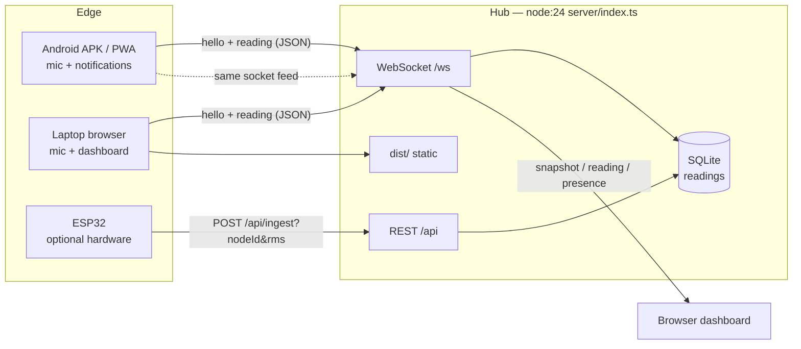
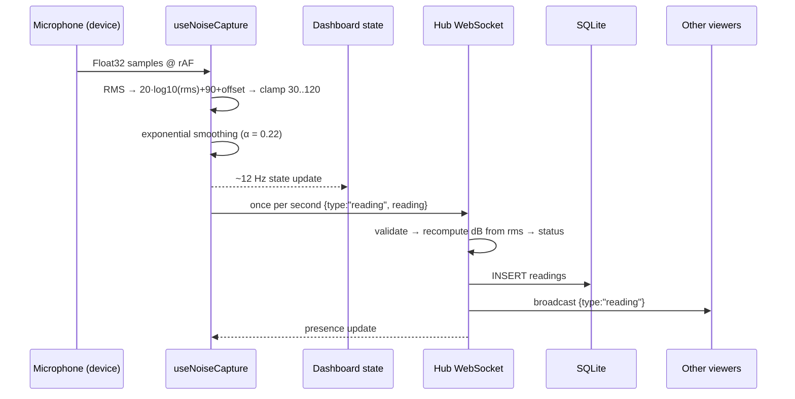
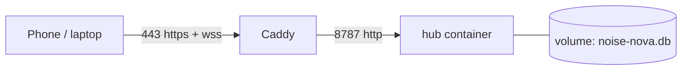

# Architecture — Noise Nova

## 1. Topology

One Node process is the whole backend. It serves the built dashboard, the REST API, the
WebSocket fan-out and the SQLite store from a single origin. A phone (APK or PWA) and a
laptop browser are both microphone nodes and both viewers.



Why one process:

- **No CORS, no split origin.** The dashboard is served by the same server that owns the
  socket, so `resolveHub()` can default to `window.location.origin`.
- **No native module.** `node:sqlite` ships with Node 24; the hub runs as plain `.ts` through
  Node's type stripping, so there is no server build step and no `better-sqlite3` rebuild on
  Windows.
- **Offline demo.** No Firebase project, no internet dependency, no third-party outage risk.

## 2. Reading pipeline



The client never decides the status the hub stores. `normaliseReading()` rebuilds every field:
strings are trimmed and length-capped, numbers coerced and bounded, and the dB value is
recomputed from `rms` whenever `rms > 0`. A client cannot post an arbitrary level and have the
server present it as measured.

## 3. Data contracts

### 3.1 SQLite (`readings`)

```sql
CREATE TABLE readings (
  id INTEGER PRIMARY KEY AUTOINCREMENT,
  node_id TEXT NOT NULL,
  node_label TEXT NOT NULL,
  kind TEXT NOT NULL,          -- laptop | phone | board
  source TEXT NOT NULL,        -- browser-mic | android-mic | esp32
  ts INTEGER NOT NULL,         -- epoch ms, assigned by the hub if implausible
  db REAL NOT NULL,            -- 30..120, estimated
  rms REAL NOT NULL,           -- 0..1 full-scale
  peak REAL NOT NULL,
  status TEXT NOT NULL,        -- QUIET | MODERATE | LOUD | VERY LOUD
  threshold REAL NOT NULL
);
CREATE INDEX idx_readings_ts   ON readings (ts DESC);
CREATE INDEX idx_readings_node ON readings (node_id, ts DESC);
```

`PRAGMA journal_mode = WAL` keeps reads non-blocking while the demo writes every second.

### 3.2 Reading (wire + client)

```ts
interface Reading {
  nodeId: string;
  nodeLabel: string;
  kind: "laptop" | "phone" | "board";
  ts: number;
  db: number;
  rms: number;
  peak: number;
  status: "QUIET" | "MODERATE" | "LOUD" | "VERY LOUD";
  threshold: number;
  source: "browser-mic" | "android-mic" | "esp32";
}

interface NodeSummary {
  nodeId: string;
  nodeLabel: string;
  kind: "laptop" | "phone" | "board";
  lastSeen: number;
  db: number;
  status: "QUIET" | "MODERATE" | "LOUD" | "VERY LOUD";
  source: "browser-mic" | "android-mic" | "esp32";
  readings: number;
}
```

### 3.3 REST

| Method | Path | Purpose | Notes |
|---|---|---|---|
| `GET` | `/api/health` | Liveness + counts | `{ok, service, nodes, readings, uptimeSeconds}` |
| `GET` | `/api/nodes` | Presence + latest per node | Merged from DB and in-memory presence |
| `GET` | `/api/readings?limit=N` | Recent readings, oldest→newest | `limit` clamped 1..2000, default 200 |
| `POST` | `/api/ingest` | ESP32/HTTP ingestion | JSON body or query params |

Ingest example, no JSON encoder required on the board:

```bash
curl -X POST "http://192.168.1.42:8787/api/ingest?nodeId=esp32-a&rms=0.05&peak=0.08&nodeLabel=Lab%20A"
```

Response: `202 {ok:true, reading}`. Missing `nodeId` → `400`. Wrong method → `405`.
Bodies over 64 KB are rejected.

### 3.4 WebSocket

`GET /ws` upgrade. Optional `?token=` when `HUB_TOKEN` is set.

Client → hub:

```json
{ "type": "hello",  "node": { "nodeId": "phone-ab12", "nodeLabel": "Android node", "kind": "phone" } }
{ "type": "reading", "reading": { "...": "Reading" } }
{ "type": "ping" }
```

Hub → client:

```json
{ "type": "snapshot", "nodes": [], "readings": [], "serverTime": 1790000000000 }
{ "type": "reading",  "reading": { "...": "Reading" } }
{ "type": "presence", "nodes": [] }
{ "type": "pong" }
```

Limits: one reading per socket per 450 ms; a malformed message is dropped silently rather than
closing the socket.

## 4. Client state and storage

| Key | Content | Cap |
|---|---|---|
| `nn_prefs_v1` | node identity, label, threshold, sound, push, calibration | one object |
| `nn_readings_v1` | this device's persisted readings | 600 |
| `nn_alerts_v1` | alert log | 50 |
| `nn_hub_v1` | paired hub URL + token | one object |
| `nn_calibration_v1` | calibration offset | one number |

The dashboard's feed is the union of local readings and hub readings, de-duplicated by
`nodeId:ts`. Local-first: if the hub is down, the UI still shows this device's live data and
marks the hub offline.

## 5. Security boundaries

- **Trust boundary:** everything arriving at `/api/ingest` or `/ws` is untrusted. Fields are
  rebuilt, not merged.
- **Integrity:** dB is recomputed from RMS server-side; status is derived server-side.
- **Auth:** optional shared token (`HUB_TOKEN`), accepted as `?token=` or `x-hub-token`.
  Empty token = open hub, intended for a trusted LAN only.
- **Transport:** LAN is plain HTTP/WS. For internet exposure, `deploy/Caddyfile` terminates
  TLS and only Caddy is published.
- **Path safety:** static serving resolves the requested path and rejects anything outside
  `dist/`; unknown paths fall back to `index.html` for client routing.
- **Privacy:** no audio buffer is serialised, stored or transmitted — only the numeric summary.
- **PWA cache:** the service worker caches the shell only. `/api` and `/ws` are excluded so a
  stale reading can never be shown as live.

Known gaps (documented, not hidden): no per-node authentication, no TLS on LAN, no rate limit
on HTTP ingest beyond body size, single-process SQLite.

## 6. Deployment



- `deploy/Dockerfile` — two stages: build the dashboard, then a runtime with production deps
  only (`ws`). The runtime copies `server/` and the two shared `src/lib` modules the hub
  imports.
- `deploy/docker-compose.yml` — `hub` exposed only on the compose network, Caddy publishing
  80/443, named volumes for SQLite and certificates.
- `deploy/Caddyfile` — WebSocket-aware reverse proxy, security headers, automatic HTTPS.
  Cloudflare proxying (orange cloud) breaks HTTP-01; use DNS-only or DNS-01.
- Environment: `PORT`, `HUB_TOKEN`, `DB_PATH`, `VITE_HUB_URL` (build-time only).

## 7. Module map

| File | Responsibility |
|---|---|
| `src/lib/noise.ts` | Pure math: RMS, dB mapping, smoothing, bands, formatting, presets |
| `src/lib/types.ts` | Wire and client types, caps, cooldown |
| `src/lib/useNoiseCapture.ts` | Mic graph lifecycle, error classification, 12 Hz / 1 Hz cadence |
| `src/lib/hub.ts` | URL resolution, pairing, WebSocket client with backoff and heartbeat |
| `src/lib/nodes.ts` | Merge persisted readings with hub presence (feed wins on freshness) |
| `src/lib/storage.ts` | LocalStorage schema and caps |
| `src/lib/native.ts` | Capacitor notifications, haptics, web fallbacks |
| `src/lib/sound.ts` | Synthesised click/chime, mute persisted |
| `src/lib/csv.ts` | RFC-safe CSV generation and download |
| `src/server` | REST, WS, SQLite, static serving, validation |
| `server/index.ts` | Everything server-side, one file, no framework |
