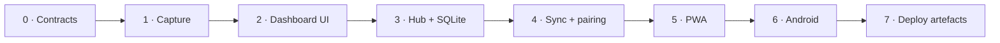

# Phases — Noise Nova

Build order, checkpoints, and what actually shipped.



| Phase | Milestone | Completion criteria | Status |
|---|---|---|---|
| 0 | Data contracts | `noise.ts`, `types.ts` frozen; self-check runs | **Done** |
| 1 | Microphone capture | Real RMS → dB, 1 Hz emissions, tracks released | **Done** |
| 2 | Dashboard | Meter, 4 cards, chart, threshold, alerts, roster, history, CSV | **Done** |
| 3 | Hub | Static + `/api` + `/ws` + SQLite, ingest, validation | **Done** |
| 4 | Sync | Pairing, reconnect, presence, union feed, dedupe | **Done** |
| 5 | PWA | Manifest, real PNG icons, shell-only service worker | **Done** |
| 6 | Android | Capacitor project, permissions, notifications, debug APK | **Build configured** |
| 7 | Deploy | Dockerfile, compose, Caddy, AWS guide, firewall script | **Done** |

---

## Phase 0 — Contracts

- `src/lib/noise.ts`: `rmsFromSamples`, `dbFromRms(rms, offset)`, `clampDb`, `smooth`,
  `statusFromDb` (≤40 / ≤65 / ≤80 / >80), `THRESHOLD_PRESETS`, formatters.
- `src/lib/types.ts`: `Reading`, `NodeSummary`, `AlertEntry`, `MAX_CHART_POINTS = 60`,
  `MAX_ALERTS = 50`, `ALERT_COOLDOWN_MS = 10_000`.
- Checkpoint: `npm run check` exercises the pure functions with `node:assert`.

Empty-input behaviour decided here and never revisited: empty block → RMS 0 → floor 30 dB, not
`-Infinity` or `NaN`; empty averages → 0.

## Phase 1 — Capture

- `getUserMedia` with DSP disabled, `AnalyserNode` (`fftSize 2048`, no smoothing).
- rAF loop; UI refresh ~12 Hz; persisted reading exactly once per second.
- Teardown on stop **and** unmount; classified errors (`denied`, `unavailable`, `in-use`,
  `insecure`, `unsupported`).
- Checkpoint: OS mic indicator turns off after Stop; denied permission shows actionable copy.

## Phase 2 — Dashboard

- Meter with status-coloured arc; four stat cards; 60-point chart with threshold line.
- Threshold slider + presets; alert log with 10 s per-node cooldown; sounds; node roster.
- History table with CSV export (every cell quoted, internal quotes doubled, empty export
  still emits a header).
- Checkpoint: alert does not repeat while the level stays above threshold; CSV opens in Excel
  with a label containing a comma intact.

## Phase 3 — Hub

- `node:sqlite` schema + indexes, WAL mode, prepared statements.
- `/api/health`, `/api/nodes`, `/api/readings`, `/api/ingest`; static serving with SPA fallback
  and path-traversal guard.
- Server-side normalisation recomputes dB from RMS; 64 KB body cap; 450 ms per-socket rate
  limit; optional `HUB_TOKEN`.
- Checkpoint: `curl -X POST /api/ingest?nodeId=x&rms=0.05` returns 202 and appears in
  `/api/readings`.

## Phase 4 — Sync

- `useHub`: connect, `hello`, publish, heartbeat (20 s), exponential backoff (0.8 s → 10 s).
- Pairing dialog probes `/api/health` before saving; `host:port#token` accepted.
- Feed = union of local + hub readings keyed by `nodeId:ts`; hub snapshot replay is excluded
  from alerting.
- Checkpoint: kill the hub → status goes offline → restart → dashboard reconnects without a
  reload; two devices see each other.

## Phase 5 — PWA

- `manifest.webmanifest` with 192/512/maskable PNGs generated by `scripts/make-icons.mjs`.
- `sw.js` caches the shell; `/api` and `/ws` excluded; versioned cache cleanup on activate.
- Checkpoint: Chrome offers Install; DevTools offline reload still opens the app shell and
  honestly reports the hub offline.

## Phase 6 — Android

- Capacitor 8, `appId live.sahnirmaan.noisenova`, bundled assets (`webDir: dist`), HTTPS
  scheme, cleartext + mixed content allowed for the LAN socket.
- Manifest: `RECORD_AUDIO`, `MODIFY_AUDIO_SETTINGS`, `INTERNET`, `POST_NOTIFICATIONS`;
  notification small icon `ic_stat_noise`.
- Local notifications: channel `noise_breach`, importance 5, vibration, lights; haptics on
  breach.
- Commands: `npm run cap:sync`, `npm run apk:build`, `npm run apk:open`.
- Checkpoint: APK installs, asks for mic + notification permission, captures, shows a
  notification above the threshold, and pairs with the laptop hub by IP.

## Phase 7 — Deploy

- Two-stage `deploy/Dockerfile` (build dashboard, runtime with production deps only).
- `docker-compose.yml` with hub + Caddy, named volumes for SQLite and certificates.
- `Caddyfile` with WebSocket-aware proxy, HSTS, and Cloudflare guidance.
- `scripts/allow-firewall.ps1` for the LAN demo; `deploy/DEPLOY_AWS.md` walkthrough.
- Checkpoint: `docker compose up -d --build`, open `https://<host>`, post an ingest reading,
  see it on the dashboard.

---

## Regression checklist (run before submission)

```bash
npm run build     # tsc --noEmit + vite build
npm run check     # 15 assertions
npm start         # hub serves dist/
curl http://localhost:8787/api/health
```

Then, by hand:

1. Laptop mic start → meter moves → stop → mic indicator off.
2. Phone and laptop both monitoring → both appear in the roster → switch between them.
3. Threshold to 40 → chime, log entry, native notification; no repeat within 10 s.
4. Hub killed → offline badge; hub restarted → automatic reconnect.
5. History → CSV opens with correct columns and escaped labels.
6. PWA install prompt appears; offline reload shows the shell and an offline hub.
